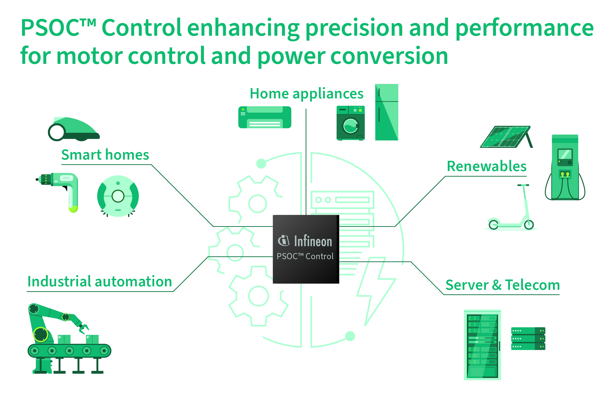

# PSOC™ Control Performance Line Training

Build your way from a first look at the PSOC™ Control C3 performance line to focused, hands-on development. Start with the PSC3P8 fundamentals, then continue with application-focused training such as power conversion.

<p align="center"></p>

## Access the training material

There are two ways to get the training material:

- **Open a single training:** Select any course link on this page to open that training on Infineon GitHub. No cloning is needed.
- **Get everything:** Clone this repository with submodules to download all courses under `courses/` at once:

  ```sh
  git clone --recurse-submodules https://github.com/luisreynosoIFX/psoc-training-control-c3-performance.git
  ```

  If you already cloned it without submodules, initialize them with:

  ```sh
  git submodule update --init --recursive
  ```

## Get started

### PSC3P8 fundamentals (E2)

[PSOC™ Control C3 P8 training](https://github.com/Infineon/mtb-training-psoc-control-c3p8) — Introduces the PSOC™ Control C3 P8 device through 12 sessions covering its applications, architecture, peripherals, power, security, and safety. Assumes basic ModusToolbox™ knowledge and uses the KIT_PSC3P8_EVK.

1. Platform introduction and PSC3P8 device family
2. Top applications and use cases
3. Core architecture and memory: CPU, interrupts, and clocks
4. I/O and serial connectivity
5. Timers and analog subsystems
6. CORDIC math accelerator
7. Power management strategies
8. Middlewares and EEPROM setup
9. Security, boot, and IPC
10. Functional Safety Test Library (STL)
11. IDE workflows for Keil, IAR, and ModusToolbox™
12. Differences between the performance line and the main and entry line

## Choose a deeper dive

### Power conversion

[PSC3P8 power (E3)](https://github.com/Infineon/mtb-training-psoc-control-c3p8-power) — Develop digital power conversion applications on PSC3P8 with hands-on labs. Uses the KIT_PSC3P8_EVK with a power stage board.

1. Digital power conversion overview
2. Power topologies and control requirements
3. PWM generation and timer configuration for power stages
4. ADC sampling and analog front end
5. Digital control loops and compensator design
6. Protection, fault handling, and functional safety
7. Tuning, debugging, and visualizing a power application

## More PSOC™ Control training

Using a PSOC™ Control C3 main or entry line device? Go to the [PSOC™ Control Main / Entry Line training](https://github.com/luisreynosoIFX/psoc-training-control-c3-entry-main) page.

## Training index

Browse the [ModusToolbox™ training page](https://github.com/luisreynosoIFX/training-modustoolbox) for PSOC™ and other device training.
